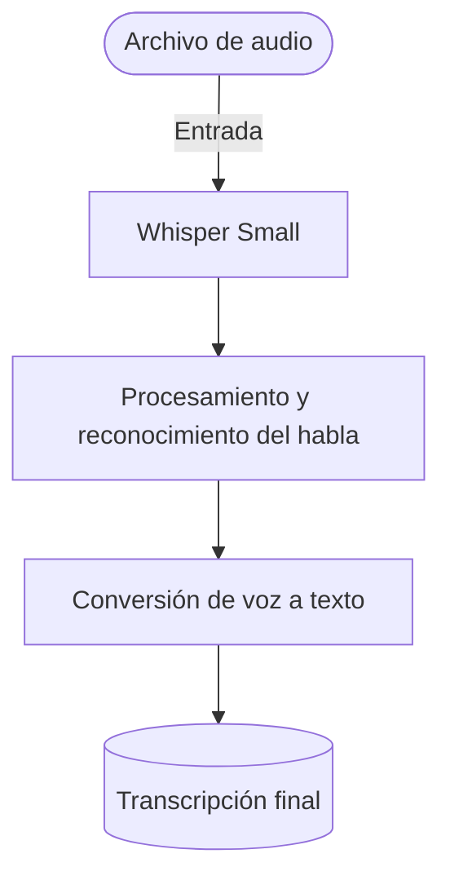

# Model Card del modelo en Hugging Face: Whisper (speech-to-text)
 
**Transcripción de audio a texto mediante Whisper Small.**
 
Proyecto integrador · Herramientas de IA
Grupo: B1 · Equipo: 4
 
##  Integrantes
| Nombre | Función en el equipo |
|------|-----------|
| Fernanda Narahi Rayas Flores | Desarrollo del modelo whisper de transcripción |
| Paulina Alejandra Ramírez Olmos | Desarrollo colaborativo del modelo Whisper Small |
| Luciano Nery Reynoso Orozco | Integrador del modelo whisper Small|
| Jorge Andrés Ruiz López | Desarrollo de despliegue del modelo de transcripción |

## 1. Caso de uso

Estudiantes de cualquier nivel que graban clases largas o con mucha teoría y necesitan consultar la información sin volver a escuchar todo el audio.

El sistema utiliza Whisper Small para convertir las grabaciones de audio en texto, facilitando la búsqueda y el repaso de los contenidos.

- **Entrada:** un archivo de audio (MP3, M4A o WAV) con la grabación de una clase, reunión o discurso.
- **Salida:** la transcripción completa del audio en formato de texto.
 
###  Cómo funciona
 

 
## 2. Modelo abierto elegido
 
| Dato | Respuesta |
|------|-----------|
| Identificador | [openai/whisper-small](https://huggingface.co/openai/whisper-small) |
| Tarea (pipeline tag) | `automatic-speech-recognition` |
| Número de parámetros | `244 M (244,000,000)` |
| Licencia | `Apache 2.0` |
| Limitación o sesgo declarado | Es un modelo multilingüe entrenado en 99 idiomas, pero el rendimiento varía según el idioma: está más entrenado en inglés que en otros idiomas |
 
## 3. Viabilidad de hardware
 
$$
\text{Memoria mínima} = 244{,}000{,}000 \times 2\ \text{bytes} \approx 0.488\ \text{GB}
$$
 
- **VRAM disponible en Colab:** ~15 GB (GPU Tesla T4)
- **Dónde se ejecuta:** Colab con GPU
- **Por qué:** los pesos de Whisper-small en FP16 ocupan solo ~0.49 GB, muy por debajo de los ~15 GB de la T4. Esta cifra es solo de los pesos; en ejecución se necesita memoria extra para activaciones y buffers.
 
## 4. Riesgo ético
 
- **Riesgo:** Las grabaciones pueden contener información personal o conversaciones privadas de estudiantes y profesores.
- **Mitigación:** Obtener consentimiento antes de procesar las grabaciones, no almacenar los audios después de la transcripción y eliminar datos personales innecesarios del texto resultante.
Whisper Small: Transcripción de audio a texto
Descripción del proyecto
Este proyecto busca facilitar la conversión de audio a texto mediante el modelo de inteligencia artificial Whisper Small. Está dirigido principalmente a estudiantes que necesitan transcribir clases, reuniones o discursos para consultar la información de manera escrita y facilitar su estudio.
Integrantes del equipo

## 5. Cambios realizados desde la Fase 1
A partir de la revisión de la primera fase , se realizaron ajustes para enfocar el ptoyecto exclusivamente en Whisper Small. Se organizó  la documentación  del repositorio, se definió con mayor claridad el caso de uso  y se agregó  un diagrama para representar el proceso de transcripción de audio a texto
## 6: Próximo
- [ ] Investigar y documentar el funcionamiento del modelo
- [ ] Preparar el entorno en Colab
- [ ] Implementar el modelo para realizar transcripciones
- [ ] Probar
- [ ] Evaluar
- [ ] Documentar los resultados y las posibles limitaciones

## 7. Referencias
Whisper Small – Hugging Face
Repositorio oficial de Whisper – OpenAI
Artículo de investigación: Robust Speech Recognition via Large-Scale Weak Supervision

 
